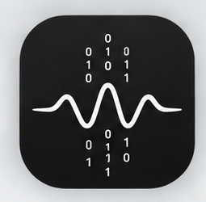
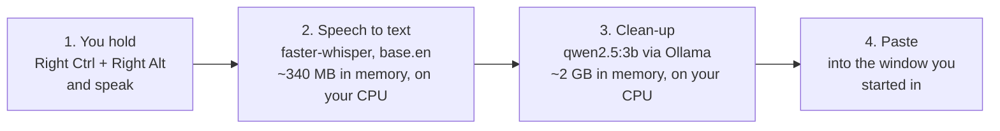
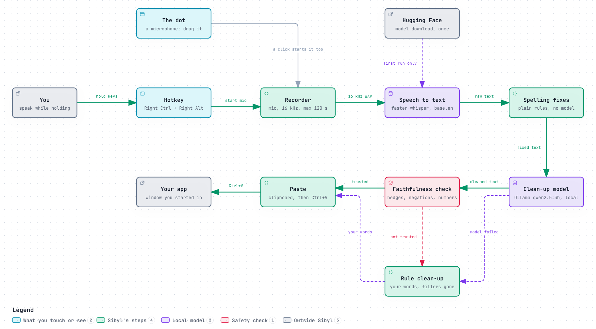

<div align="center">



# Sibyl

**An open-source, locally hosted, privacy-first clean-up and formatting tool for
what you dictate.**

Hold a key, speak, let go. Sibyl writes your own words into the window you
started in — without the "um", without the parts you took back, with
punctuation and paragraphs.

Nothing leaves your laptop. That is structural, not a promise: there is no
cloud code path to switch off.


[Install](INSTALL.md) · [User guide](USER_GUIDE.md) · [How it works](docs/HOW-IT-WORKS.md) · [Privacy audit](#privacy-audit) · [Contributing](CONTRIBUTING.md) · [Security](SECURITY.md)

</div>

---

<!-- DEMO GIF GOES HERE.
     Record: open Notepad, hold Right Ctrl + Right Alt, dictate a short list
     with a filler and a correction in it, let go, show the pasted result.
     Save as docs/demo.gif, add "docs/demo.gif" to ALLOWLIST in
     build_release.py (or the release will not include it), and replace the
     line below with:
       -->

> **Demo recording not yet made.** See the comment in this file's source for
> what it should show.

---

## Contents

- [Why Sibyl](#why-sibyl)
- [Features](#features)
- [How it works](#how-it-works)
- [Built with](#built-with)
- [Quick start](#quick-start)
- [Privacy audit](#privacy-audit)
- [Known limitations](#known-limitations)
- [Troubleshooting](#troubleshooting)
- [Project layout](#project-layout)
- [Running the tests](#running-the-tests)
- [How it was built](#how-it-was-built)
- [Related projects](#related-projects)
- [Licence](#licence)
- [Acknowledgements](#acknowledgements)

---

## Why Sibyl

Dictation software gives you a transcript. A transcript is not writing. It holds
every "um", every false start, every "actually, scrap that", and no paragraphs.

Sibyl closes that gap, and stops there:

- **It tidies. It does not rewrite.** Fillers go. Sentences you took back go.
  Remarks about the act of dictating go. Your actual words stay as you said
  them — including hedges like "probably" and "maybe", which carry meaning.
- **It formats lightly.** A spoken list becomes a bullet list. A change of
  subject becomes a paragraph break.
- **It never invents.** A check runs on the model's answer before anything is
  pasted. If the answer grew, lost a hedge, lost a "not", wrote a number you
  never said, or added a word, the answer is thrown away and your own
  rule-cleaned words are pasted instead. You never lose a dictation to a model
  having a bad day.
- **It is offline by construction, once installed.** Everything Sibyl itself
  sends goes through `requests`, and only ever to `127.0.0.1:11434` — the model
  runtime on your own machine. Turn your wifi off and Sibyl works exactly the
  same. **The one exception is the first run**, which downloads the speech model
  (about 150 MB) from Hugging Face. After that it is cached on your disk and
  loaded from there, with no contact with Hugging Face at all, unless a file of
  it goes missing. Nothing you dictate is ever sent anywhere, on the first
  run or any other.
- **It is one key and one model.** No modes, no menus, no account.

**What it is not:** a meeting transcriber, a voice assistant, a translator, or a
writing assistant that answers questions. If you dictate "write me an email
declining the invitation", Sibyl pastes that sentence, tidied. It does not
write the email.

---

## Features

- **Hold to talk.** Hold Right Ctrl + Right Alt, speak, let go. The text lands
  in the window you started in.
- **Tap for hands-free.** Tap both keys and talk for as long as you like; tap
  again to send. Any other key throws a hold away.
- **The dot.** A small microphone above the taskbar shows what Sibyl is doing by
  its colour, and never shows your words. Click it to dictate hands-free; a
  tick sends and a cross discards. **Drag it anywhere** if it is in the way: it
  stays where you drop it.
- **Paste again.** Right-click the dot to see the last text and paste it again
  wherever your cursor is now.
- **Your own word list.** Hand the recogniser the names and jargon you actually
  say (`STT_HOTWORDS`), and it gets most of them right.
- **A warning before the cap.** One capture runs to two minutes. A tone sounds
  ten seconds before, and at the cap Sibyl sends what it has.
- **The fallback.** When the model's answer cannot be trusted, or the model
  fails, you get your own words, tidied by fixed rules, rather than nothing.

---

## How it works

Four steps. Every one of them runs on your machine.



In a little more detail, with the safety net drawn in. **[How it works](docs/HOW-IT-WORKS.md)**
walks through it step by step.



| Step | What does the work | Why that choice |
|---|---|---|
| Record | `sounddevice`, 16 kHz mono | Whisper resamples to 16 kHz anyway, so recording higher would cost time for nothing |
| Speech to text | `faster-whisper`, `base.en`, int8 on CPU | Measured against three other contenders over twelve recordings. `small.en`, the only larger one, was 1.5 s slower on twice the memory and **barely better at names** (20% against 13%, both without the word list below) |
| Names and jargon | The recogniser is handed your own word list (`STT_HOTWORDS`) | Measured: word errors fell from 10.0% to 4.2%, names right rose from 13% to 80%, for 0.03 s. Cheaper and better than a bigger model |
| Spelling fixes | Plain deterministic rules | A known mis-hearing ("SQ Lite" → "SQLite") is fixed by code. Instant, and cannot be got wrong |
| Clean-up | `qwen2.5:3b` through Ollama | Measured against `qwen2.5:1.5b` and `qwen3.5:0.8b`. Best of the three: it dropped "I think" once in three runs, where `1.5b` dropped a phrase on every run and `0.8b` kept a corrected-away number on every run |
| Check | Plain code, no model | Rejects an answer that grew, lost a hedge, lost a "not", wrote a number never said, added a word, or kept too little. Limits set from 78 measured answers, not guessed, with one later exception set from 132 |
| Paste | Windows' clipboard directly (`pyperclip` on macOS), then `pyautogui` | The clipboard is written **before** the paste, so a paste that lands in the wrong place is still recoverable by hand. Sibyl brings back the window you started in first; if it cannot, it does not paste, and the text waits on the clipboard. The clipboard entry carries the opt-out Microsoft documents for Windows' clipboard history (Win+V) and cloud clipboard |

Typical timings on a 2021 ultrabook (Intel Iris Xe, no graphics card):

| Dictation | Time from letting go to pasted text |
|---|---|
| 10 words | about 1 second (0.9–1.3 s measured over three runs) |
| 30–40 words | about 3 seconds (2.6–3.5 s over three runs) |
| First capture after 30 idle minutes | about 20 s — Ollama unloads the model to free memory, and has to load it again |

Those are ranges rather than single numbers on purpose. The same sentence varies
by a few tenths of a second run to run, and anything else busy on your CPU
widens it. Do not read a single timing as a measurement.

---

## Built with

| Part | What |
|---|---|
| Language | Python 3.12, one file, `sibyl.py` |
| Speech to text | [faster-whisper](https://github.com/SYSTRAN/faster-whisper) on CTranslate2, running Systran's conversion of OpenAI's Whisper `base.en` |
| Clean-up | [Ollama](https://ollama.com/) running [Qwen2.5](https://github.com/QwenLM/Qwen2.5) 3B, reached over `requests` on `127.0.0.1` only |
| Audio | `sounddevice` (PortAudio), `soundfile`, `numpy` |
| Keyboard | `pynput` |
| The dot | Tkinter for the window, drawn by Pillow, shown through Windows' own layered-window calls |
| Tray | `pystray` |
| Paste | Windows' clipboard directly, then `pyautogui` for Ctrl+V |
| Settings | `python-dotenv` |

---

## Quick start

Full step-by-step instructions, written for someone who has never installed
Python, are in **[INSTALL.md](INSTALL.md)**. The short version:

```powershell
# 1. Prerequisites: Python 3.10+ and Ollama, both on PATH.
ollama pull qwen2.5:3b

# 2. Get Sibyl and its Python libraries. Copy the address from the green
#    Code button on this repository's page, then:
git clone <that address>
cd sibyl
python -m pip install -r requirements-lock.txt   # the exact tested set, Python 3.12
# (on another Python: python -m pip install -r requirements.txt)

# 3. Run it (or double-click Start-Sibyl.cmd).
.\Start-Sibyl.cmd
```

Then **hold Right Ctrl + Right Alt, speak, and let go.** Your words appear in
whatever window you were in.

A small microphone on a grey disc appears above your taskbar: the dot. That is
Sibyl. It turns red while it listens, yellow while it works, green when it has
pasted. If it covers something, drag it anywhere; it stays where you drop it.

To get a desktop icon and (optionally) start Sibyl with Windows:

```powershell
.\Start-Sibyl.cmd install
```

---

## Privacy audit

Every feature, and where it runs. Modelled on
[ghost-pepper](https://github.com/matthartman/ghost-pepper)'s audit, because a
privacy claim you cannot check is marketing.

| Feature | Where it runs | What is sent off the machine |
|---|---|---|
| Recording your voice | Your microphone, into a temporary file on your disk | Nothing |
| Speech to text | `faster-whisper` in Sibyl's own process | Nothing — **but see the first-run exception below** |
| Spelling fixes | Plain Python, in the same process | Nothing |
| Clean-up by the model | Ollama, on `127.0.0.1` port 11434 | Nothing. `127.0.0.1` is your own machine, by definition |
| Pasting | Your clipboard and a simulated Ctrl+V | Nothing. The clipboard entry carries the opt-out Microsoft documents for clipboard history and for syncing to your other devices. Checked by hand on Windows 11 with clipboard history switched on: a dictation does not appear in Win+V, while text copied by hand does |
| Crash and timing log | `%LOCALAPPDATA%\Sibyl\sibyl.log` on your disk | Nothing |
| Where you dragged the dot | `%LOCALAPPDATA%\Sibyl\notch.json` on your disk: a position on the screen, nothing else | Nothing |
| Stopping a second copy starting | A socket held open on `127.0.0.1` port 49731 while Sibyl runs. It never accepts a connection or sends anything; a second copy finds the port taken and stops | Nothing. `127.0.0.1` cannot be reached from another machine |
| Updates, telemetry, analytics, accounts | **None exist** | Nothing |

### The one exception, stated plainly

**Installing needs the internet. Using it does not.**

Three things are downloaded once, and all three are public files that have
nothing to do with you:

| Downloaded once | From | When |
|---|---|---|
| Python libraries | PyPI | When you run `pip install` |
| The clean-up model, ~1.9 GB | Ollama's library | When you run `ollama pull` |
| The speech model, ~150 MB | Hugging Face | **Automatically, on Sibyl's first run** |

That third one is the surprising one, so it is worth being explicit: the first
time Sibyl starts, `faster-whisper` fetches the `base.en` weights over its own
HTTP connection — not through Sibyl's `requests` calls, and not to `127.0.0.1`.
It is cached on your disk and loaded from there; only a file of it that has
gone missing is ever fetched again.

One optional fourth, for developers only: `python eval_stt.py --download`
fetches the larger `small.en` speech model (about 464 MB) from Hugging Face, to
compare speech models. Sibyl itself never runs it.

**What is never sent, on the first run or any other: anything you said, anything
that was pasted, your clipboard, your window titles, your `.env`, or any
identifier for you or your machine.** The downloads are one-way fetches of
public files.

**How you can verify all of this yourself, without reading all the code:**

1. **Turn your wifi off and use Sibyl** — after the first run has completed. It
   works identically. If you do it *before* the first run, the dot goes red
   because the speech model is not on disk yet; that is the exception above, and
   it is the only thing wifi changes.
2. **Search the project for network code.** Everything Sibyl sends goes through
   `requests`, and every call goes to `http://127.0.0.1`, this computer, even
   when a proxy is set. The one setting that could change that,
   `SIBYL_OLLAMA_HOST`, accepts only a port on `127.0.0.1`; anything else is
   refused at start. The only other socket in Sibyl's own code is the
   one-copy lock above, which sends nothing. (`faster-whisper` brings its own
   network code, for that one-time download.)
3. **Watch the connections.** With the models already cached,
   `netstat -ano | findstr 11434` shows a loopback connection and nothing else,
   and `netstat -ano | findstr 49731` shows only the lock, listening on
   `127.0.0.1`. Run them during a dictation and confirm nothing else appears.

**What the log does and does not hold.** The log exists because Sibyl runs
without a console window, so errors need somewhere to go. It records times,
states and errors. It **never** records what you said, what was pasted, or
which window it went into — those go through a function that writes a stand-in
placeholder to the file instead. This is enforced by an automated test that
dictates a known phrase and then searches the log for it.

**Your recordings are deleted.** Each capture writes a temporary WAV file and
deletes it in a `finally` block, so it goes even if the step after it crashes.
Quitting mid-dictation deletes the file first. If a deletion ever fails, Sibyl
tells you the exact path so you can remove it yourself.

**One thing to know about your own `.env` file.** It holds your hotkey, your
model names and your own word list for the recogniser — which may include real
names of people you work with. It is gitignored. Do not paste it into a bug
report.

---

## Known limitations

Stated plainly, because finding these out yourself is worse.

Pasting was checked by hand in Notepad, a browser, Slack, Teams, VS Code,
Windows Terminal and the classic Command Prompt, and worked in all of them.

- **Windows only, in practice.** Built and tested on Windows 11. The status dot
  above the taskbar is Windows-specific; on macOS the code skips it, and the
  rest is untested. Linux is untested.
- **English only.** The speech model is `base.en`, an English-only model. Other
  Whisper models exist, but nothing here is tuned or measured for them.
- **You need the memory.** Roughly 2 GB for the clean-up model plus ~340 MB for
  the speech model, held in RAM while Sibyl runs. On a 16 GB machine with a
  normal working load that is comfortable; on 8 GB it will be tight.
- **The first capture after an idle spell is slow.** Ollama unloads the model
  after 30 idle minutes to give the memory back. The next clean-up then takes
  about 20 seconds instead of 3. This is a deliberate trade, not a bug.
- **About eight known clean-up failures.** The project's own scored test has 50
  cases and the model passes **41 to 42** of them. The 17 newest, which check
  that no meaning is reversed, passed 101 of 102 answers measured, and the check
  caught the one miss. The other 33 sit at **24
  to 26** across nine runs, so roughly seven to nine of them fail — and **the
  exact set shifts a little from run to run**, because the model is not
  deterministic. They fall into three kinds:

  | Kind | What goes wrong |
  |---|---|
  | A dictated instruction (2 cases) | "Write me a polite email declining…" gets partly carried out instead of tidied |
  | A long rambling passage (about 5 cases) | A hedge such as "probably", "I think" or "as well" is dropped |
  | A short sentence ending "as well" (1 case) | "as well" is dropped |

  **The check catches nearly all of them** — 8 of 8 in one measured run, 7 of 8 in
  another, where it missed a filler the model had left mid-sentence. So the
  normal outcome of a failure is that you get your own words rather than a wrong
  answer, but it is not a guarantee. Read what lands.

  Seven changes to the prompt's wording have been measured: six made things
  worse and broke cases that had been passing, and the seventh did not hold up
  when measured again. Fixing these properly needs a different model, not more
  English.
- **Right Alt is AltGr on many keyboards.** On UK, German, French and other
  non-US layouts, Right Alt types special characters. Pick a different hotkey in
  `.env` if that is your layout.
- **It pastes into the window, not the tab.** Sibyl puts your text back into the
  window you started speaking in. If you switch browser tabs while it works, the
  text lands in the tab now showing.
- **Sibyl cannot hear its hotkey while a program running as administrator is
  in front.** Windows walls such programs off from ordinary ones: Sibyl can
  neither type into them nor hear the keys you press while one is in front.
  Nothing is recorded and the dot stays grey. Dictate somewhere else and copy
  the text across.
- **In a terminal, Ctrl+V is not always paste.** Some programs running inside a
  terminal, such as certain editors and shells, treat Ctrl+V as a different key.
  Your text is still on the clipboard; paste it the way that program expects.
- **One screen, one scaling.** The dot lives on your main screen. You can drag
  it anywhere on that screen, but not onto another one. With several screens at
  different display scaling, it may be placed or sized wrongly there. Untested.
- **No packaged installer.** You install Python and Ollama yourself. A
  self-contained `.exe` is a possible future step, not a current one.

---

## Troubleshooting

Each stage of Sibyl can be run on its own, so a failure names its own layer.

| Symptom | Try this | What it means |
|---|---|---|
| `.\Start-Sibyl.ps1` refuses to run | `.\Start-Sibyl.cmd` | Windows blocks PowerShell scripts by default. `Start-Sibyl.cmd` runs the same script with that rule lifted for one run, and changes no setting |
| The hotkey does nothing | `.\Start-Sibyl.cmd hotkeys` | Prints every key your keyboard actually reports, with the number Windows sent. If your keys are not listed, pick different ones in `.env`. Dead in one program only? It may be running as administrator; see Known limitations |
| Nothing is recorded | `.\Start-Sibyl.cmd mic` | Records 5 seconds to `test_recording.wav` and reports how loud it was. A warning about a low peak means your microphone is muted or too quiet. If this fails at all, it is your microphone or its Windows permission, not Sibyl |
| The dot goes red saying something failed | `.\Start-Sibyl.cmd ollama` | Checks the model runtime is running and the model is installed. `ollama serve` starts it |
| It pastes untidy words, not clean ones | `python sibyl.py --test-llm "um so I need to uh buy milk and bread"` | This is the check doing its job: the model's answer was rejected, so your own words were pasted. This command shows you the model's raw answer and its timing |
| Text goes to the wrong window | Right-click the dot, then **Paste again** | Sibyl pastes where you started. Recall pastes wherever your cursor is now |
| No idea what happened | Open `%LOCALAPPDATA%\Sibyl\sibyl.log` | Every state, timing and error, with a timestamp per line. No dictated text |
| Everything is slow | Check `Task Manager` → Memory | If the machine is swapping to disk, every stage suffers. Sibyl needs its ~2.4 GB resident |

More commands, and every setting, are in **[USER_GUIDE.md](USER_GUIDE.md)**.

---

## Project layout

| File or folder | What it is |
|---|---|
| `sibyl.py` | The whole app, one file in nine numbered sections, read top to bottom |
| `Start-Sibyl.cmd`, `Start-Sibyl.ps1` | The launcher: start, `check`, `install`, `uninstall`, `hotkeys`, `mic`, `ollama` |
| `requirements.txt`, `requirements-lock.txt` | The Python libraries: minimum versions, and the exact tested set |
| `.env.example` | Every setting, commented out |
| `test_*.py` | Nine automated test files. None needs a microphone |
| `eval_cleanup.py`, `eval_stt.py` | The two scored measurements: the clean-up, and the speech model |
| `build_release.py` | Builds the public copy and audits it for anything private |
| `docs/` | [How it works](docs/HOW-IT-WORKS.md), and the architecture picture |
| `sibyl.ico`, `brand/` | The icon and the logo |
| `INSTALL.md`, `USER_GUIDE.md`, `CONTRIBUTING.md`, `SECURITY.md`, `LICENSE` | The other documents |

---

## Running the tests

```powershell
.\Start-Sibyl.cmd check
```

That runs every automated test, over 500 of them, plus a live clean-up. It
needs Ollama running, **moves your mouse pointer for a few seconds** (one test
clicks the dot with real mouse input) and borrows your clipboard. How to run
one file at a time, and how to measure a change to the clean-up, is in
**[CONTRIBUTING.md](CONTRIBUTING.md#running-the-tests)**.

---

## How it was built

Sibyl was built by one person, working with
[Claude Code](https://claude.com/claude-code), Anthropic's AI coding assistant.

**Measure first.** The clean-up is judged by a 50-case scored test, always run
three times, because a single run varies. The model, the speech model and every
change to the prompt were chosen by that measurement, and most proposed changes
were rejected by it: seven prompt changes, a bigger speech model, and two other
clean-up models.

**Test first, then review.** Each fix began as a test that failed for the
stated reason, then passed. Changes went through rounds of outside review. The
publish gate that keeps private files out of this repository was checked by
deleting each of its guards in turn and confirming a test noticed. The full
story is in **[How it works](docs/HOW-IT-WORKS.md#how-it-was-built)**.

---

## Licence

**Sibyl is MIT licensed.** See [LICENSE](LICENSE). Use it, change it, ship it.

**The default clean-up model is not MIT, and this matters to you.**

Sibyl never ships a model. It tells you to run `ollama pull qwen2.5:3b`, so
nothing in this repository is a derivative of that model, and Sibyl's own MIT
licence is unaffected. But the model you download comes with its own terms, and
those apply to you:

| Model | Licence | You may use it for |
|---|---|---|
| `qwen2.5:3b` — **the default** | Qwen **Research** License Agreement | Research and evaluation only. **Not commercial use.** Commercial users must request a licence from Alibaba Cloud |
| `qwen2.5:1.5b` — the swap | Apache 2.0 | Anything, including commercial work |

**If you dictate for work, switch the model.** It is one line in your `.env`
file and no code change:

```
CLEANUP_MODEL=qwen2.5:1.5b
```

The trade, measured: the 1.5B model is about 1.3 seconds quicker, and it dropped
content on every run of the scored test where the 3B model did not. Read the
model's own terms yourself with `ollama show qwen2.5:3b --license`.

`faster-whisper`, Whisper's weights and Ollama are MIT licensed. Most of
Sibyl's Python libraries are permissive (MIT, BSD or Apache 2.0), but not all:

| Library | Licence |
|---|---|
| `pynput`, `pystray` | LGPLv3 |
| `MouseInfo`, installed by `pyautogui` | GPLv3 or later |
| `certifi`, `tqdm` | MPL 2.0 |

None of them is included in this repository. `pip` downloads each one from
PyPI, under its own licence, when you install.

---

## Acknowledgements

Sibyl is a thin layer over other people's hard work.

- **[OpenAI Whisper](https://github.com/openai/whisper)** for the speech model,
  and **[faster-whisper](https://github.com/SYSTRAN/faster-whisper)** with
  **CTranslate2** for making it fast enough to run on a laptop CPU, and
  **Systran** for the converted `base.en` model it downloads.
- **[Ollama](https://ollama.com/)** for making a local language model a
  one-line install instead of a weekend.
- **[Qwen](https://github.com/QwenLM/Qwen2.5)** (Alibaba Cloud) for the clean-up
  model.
- **`pynput`**, **`pystray`**, **`Pillow`**, **`sounddevice`** / PortAudio,
  **`soundfile`**, **`numpy`**, **`requests`**, **`python-dotenv`**,
  **`pyperclip`** and **`pyautogui`** for the unglamorous parts that are
  actually the hard ones.
